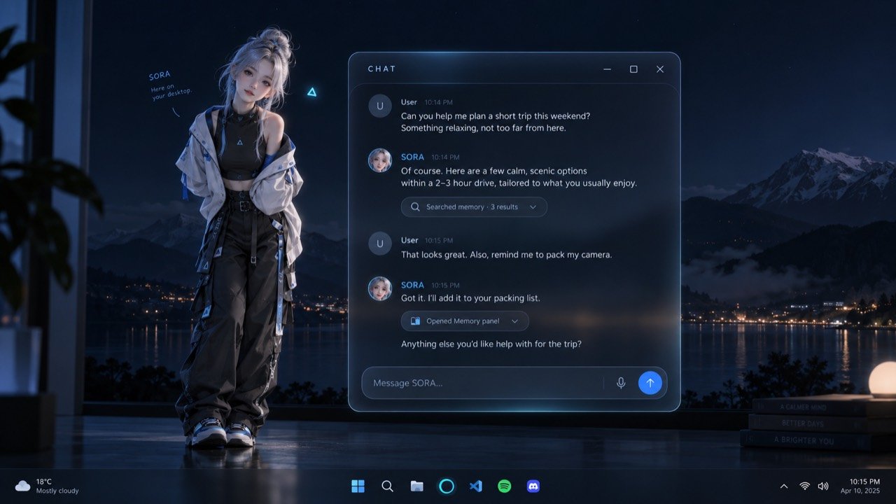
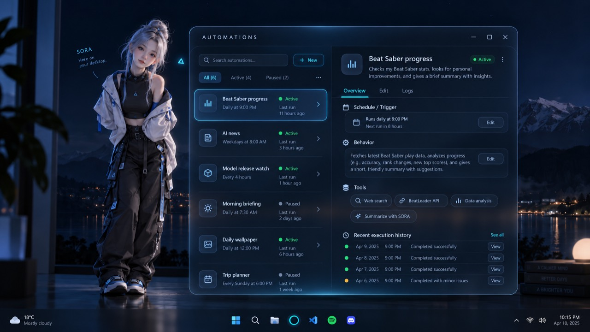
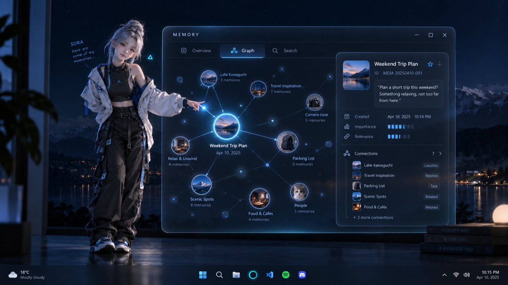
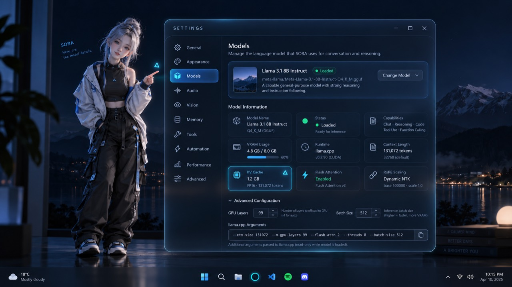

# SORA — GUI implementation roadmap

**Version:** 1.33 Documentation restructure, 5 October 2026 (no implementation change since v1.32 durable manual Automation Run now, 4 October 2026); [full revision history](docs/gui/ROADMAP_REVISION_HISTORY.md)  
**Contributor:** Original roadmap: GPT-6 (Codex); v1.1 refresh: GPT-6 Astra; v1.2–v1.32 implementation/reconciliation: GPT-6.1 Sol; v1.33 documentation restructure: Opus 5.5  
**Status:** GUI-0b in review; GUI-0a/0c/0d baseline/specification scopes complete. GUI-1/GUI-2/GUI-3 remain in progress for connected/native/live acceptance. GUI-4a/c now have typed time/data, migration12 storage/receipts/API, Core-owned worker/canonical task admission/recovery and durable manual Run now in source/components. The shared Automations panel/editor and connected/live acceptance remain missing. GUI-1–GUI-6 completion remains open; no physical/native GUI or live-model acceptance is implied by component results.  
**Destination:** A working, character-first Windows desktop GUI using the supplied Chat, Memory, Automations and Settings concepts.  
**Starting checkpoint:** Historical native look/point evidence through 2026-10-03 15:39:28 +01:00 preserved; pre-prototype source fingerprint captured at 15:57:50 +01:00. Fresh isolated GUI-0 verification is listed in §4.4; the owner's running Core/configuration was not restarted or changed.

## 1. How to use this roadmap

> **Priority is set by [VISION.md](VISION.md) and [V1.md](V1.md) (2026-10-05).** This roadmap still
> defines the GUI stages and gates, but V1's acceptance test decides what is worked on now. The
> [realignment](docs/plans/V1_REALIGNMENT_2026-10-05.md) labels every stage as V1, after V1 or
> long term.

This is the route from the **current implementation** to the approved GUI direction. It develops and supersedes the delivery guidance in the [earlier GUI draft](docs/plans/GUI-IMPLEMENTATION-DRAFT_2026-10-03.md), which remains preserved. It is a follow-on to [SORA_IMPLEMENTATION_PLAN.md](SORA_IMPLEMENTATION_PLAN.md), not a reset of completed P00–P15 work.

The [original GUI design](docs/gui/reference/SORA_GUI_Design_and_Interface_Architecture_v0.1.md) remains the approved visual/product baseline. The images in §3 are original supplied assets, copied without recompression. Proposed implementation defaults below fill the baseline's gaps; they are not claims that the owner approved every size, shortcut or scheduling rule.

Read §4 before implementation: it identifies reusable code, evidence limits and missing services. **Start with §4.0, the single current-status summary, then §4.2's reuse table. The detailed dated checkpoints §4.3–§4.33 (originally in this file) are preserved verbatim with their original numbers in [docs/gui/ROADMAP_CHECKPOINTS.md](docs/gui/ROADMAP_CHECKPOINTS.md); for unchanged areas use §4.33 (manual Run now), §4.32 (worker), §4.31 (storage/API), §4.29 (companion integration) and §4.26 (handoff) there. Later component totals do not close native/live gaps.** Execute §12 in dependency order.

**Keeping this roadmap maintainable (from v1.33):** update the §4.0 table and the §12 task line in place; append the dated checkpoint narrative to [ROADMAP_CHECKPOINTS.md](docs/gui/ROADMAP_CHECKPOINTS.md) (continuing at §4.34) and the revision entry to [ROADMAP_REVISION_HISTORY.md](docs/gui/ROADMAP_REVISION_HISTORY.md). Do not add new dated §4.n sections or "historical handoff" copies to this file. A stage is complete only when its connected acceptance gate passes. Preserve owner data, existing model attribution and historical verification records. Keep the [overview](SORA_OVERVIEW.md) intact.

Near-term GUI work must follow the [static local access direction](docs/plans/VISION-ALIGNMENT_2026-10-01.md). Repeated per-file/window/tool approval prompts must not return through the redesign. Remote/guest policy remains separate.

## 2. The finished experience

SORA ordinarily exists on the desktop without a permanent application frame. The user can summon Chat, Memory, Automations or Settings by avatar interaction, a shortcut, a transient command menu or conversation. Essential controls also work when the model, avatar or Core is unavailable.

Chat is an extension of the conversation. Memory makes retained context inspectable. Automations provides actual scheduled work and run history. Settings exposes the complete supported configuration progressively. SORA can open/select/reference her own panels through bounded semantic actions, while the user remains in control of saved edits, configuration and disruptive navigation.

Task progress, artifacts, board notes, agent selection and project evidence remain accessible as secondary surfaces. Closing Chat does not stop SORA, end an independent task or silently close the microphone. Default presence is quiet and panels do not steal focus during ordinary work.

Completion has three dimensions:

1. **Function:** all four primary panels operate on real Core records and supported services.
2. **Presentation:** the supplied identity is recognizable, readable and usable across normal desktop conditions.
3. **Integration:** ordinary launch, restart, settings, voice, tasks and avatar coexist without competing state or duplicate processes.

## 3. Reference package

All references are stored in [docs/gui/reference](docs/gui/reference/README.md). Original filenames, byte sizes and SHA-256 hashes are recorded in [manifest.json](docs/gui/reference/manifest.json). These are visual references, not screenshots of implemented SORA.

### Chat — Photo 2



Preserve the airy transcript, minimal composer and expandable evidence chips. Retain the independent avatar/panel composition. Real desktop wallpaper and content must remain arbitrary; the scene is not a required background.

### Automations — Photo 3



Preserve list/detail navigation, active/paused filters and overview/edit/log separation. Example integrations and run results are illustrative; supported tools and outcomes must come from Core.

### Memory — Photo 4



Preserve Overview/Graph/Search and contextual inspection. Graph links, scores and pulses must represent supported data. Decorative thumbnail nodes do not require generated images for every memory.

### Settings — Photo 5



Preserve conventional category navigation and progressive model detail. The pictured Llama/runtime values and editable argument line do not override actual provider support or the current typed-settings boundary.

## 4. Current-state baseline and evidence

### 4.0 Current status — maintained in place

**As of v1.32 implementation (2026-10-04 13:44:05 +01:00, GPT-6.1 Sol); summarised for v1.33 by Opus 5.5 on 2026-10-05 from §4.26–§4.33 and §12 without changing any status.** "Component" means source plus Python/C#/HTTP/SQLite tests and builds; it is **not** native GUI, live-model, provider, physical-device or release acceptance. No GUI stage after GUI-0a/0c/0d has a completion timestamp.

| Stage | State | Delivered in source (component-verified) | Still open before the stage can close | Detail |
|---|---|---|---|---|
| GUI-0 | 0a/0c/0d **complete** 2026-10-03 19:24:55; 0b **in review** | Source/settings baseline, host/interface specifications, connected WinForms feasibility prototype | 0b: mixed DPI, text scaling, screen reader/high contrast, framework review | §4.4 |
| GUI-1a | In progress | Opt-in windowless host, profile singleton/IPC, UI preferences v1, managed lifecycle, launcher forwarding, pending-startup Quit | Pre-API cancellation, host-loss races, physical mixed-monitor/accessibility acceptance | §4.5–§4.11 |
| GUI-1b | In progress | Shared Chat presenter, drafts, attachments, inert transcript, canonical-ID anchors, request-scoped Stop | Positive native file reading, keyboard/IME/history, accessibility | §4.12–§4.13 |
| GUI-1c | In progress | Activity, Agents/Paths, note board, Content, Integrations, attempt history, registered artifacts, activity chips | Native retained-workflow/history/chip/navigation acceptance, configured-provider runs | §4.15, §4.17–§4.18 |
| GUI-1d | In progress | Shared Voice panel, press-to-talk controls, closed-panel microphone indication | Physical spoken/device/mouth/latency/tray acceptance | §4.19 |
| GUI-2a–d | In progress | Categorised editor for all 84 AppSettings v9 fields, revision/epoch guards, retained drafts, device inventory, read-only launch details | Native input/layout, save/restart persistence, real model reload/failure recovery, device and entitlement checks | §4.20–§4.21 |
| GUI-3a | In progress | Canonical bounded Memory list/detail/search and shared Overview/Search/inspector | Native search/paging/keyboard/DPI/latency acceptance | §4.23 |
| GUI-3b | In progress | Atomic versioned correction/forget, migration 11 durable receipts, retained editor/confirmation | Native modal/conflict/receipt/Quit/accessibility acceptance | §4.25 |
| GUI-3c | In progress | Presentation transport, `find_memory`/`present_memory` chooser calls, turn-local references, retrieval events, Chat Memory chips | Connected native Chat → exact Memory selection/highlight; real small-model invocation | §4.27–§4.29 |
| GUI-4a | In progress | Migration 12 storage/API, Core-owned worker, guarded task admission/recovery, durable manual Run now | Shared Automations UI, real scheduled supported-provider run | §4.30–§4.33 |
| GUI-4b | **Not started — next source work** | — | List/All/Active/Paused/search, Overview/Edit/Logs, pause/resume/delete/Run now, task Cancel/evidence (see §4.33 "Next") | §4.33 |
| GUI-4c | In progress | Pure one-off/daily/weekly/interval/DST/missed/overlap logic; persisted worker recovery | Full persisted DST/interval and connected/native acceptance | §4.30, §4.32 |
| GUI-5 | Not started | Graph feasibility prototype only (no canonical memory relations) | Real relation storage/projection, graph, final visual design | §12 |
| GUI-6 | Not started | — | Ordinary launch default, packaging, fault/DPI/sleep matrix, end-to-end voice, release acceptance | §12 |

**Fixed versions:** AppSettings **v9**, UI preferences **v1**, database migration **12**. The ordinary default launcher is still the Desktop compatibility app; the Shell host is opt-in.

**Latest recorded regression:** 904 Python passed / 25 opt-in skipped, 8 PWA, mypy/lint/schema/compile, 369 C# and three zero-warning Windows builds, observed 2026-10-04 13:47:07 +01:00 by GPT-6.1 Sol (§4.33). **Independent rerun, 2026-10-05, Opus 5.5:** `pytest` 904 passed / 25 skipped, `ruff check` clean and `mypy --strict` clean (284 files) on the same source. C# 369/369, zero-warning builds of all three Windows clients and PWA 8/8 also confirmed. After the same day's [P03A/P06 audit](docs/verification/P03A_P06_INDEPENDENT_AUDIT_Opus-5.5_2026-10-05.md) (no GUI change): 908 passed / 25 skipped / 6 strict expected failures. Native and live checks were not rerun.

**Next (changed 2026-10-05 by owner decision):** the [V1](V1.md) acceptance test, not GUI-4b. V1 needs the GUI-0b/1/2/5c/6 parts listed in the [realignment](docs/plans/V1_REALIGNMENT_2026-10-05.md). **Automations (GUI-4), the memory graph (GUI-5a/b) and the Memory window's acceptance (GUI-3) are after V1.** No status above changes; component results still do not close native/live gates.

### 4.1 Audit boundaries

The current tree is materially ahead of the original P15.7 status paragraph and contains uncommitted/untracked implementation work. `HEAD` was `89f005f` during inspection; **that commit alone is not this baseline**. Before editing runtime code, record the current files/configuration and reconcile the working tree without resetting or discarding it.

The original v1.0/v1.1 refresh used source inspection and existing evidence, not fresh runtime verification. Earlier evidence remains attributed to its contributor. The [frontend alignment tracker](docs/verification/FRONTEND_ALIGNMENT_TRACKER_2026-10-01.md) retains its historical wording. Implementation has now resumed under the owner's GUI goal: GUI-0a revalidated and fingerprinted the live starting source; §4.4 records new isolated tests. None of this establishes a currently working real model, provider entitlement or physical microphone. Later dated entries take precedence over stale summary rows only for their narrow scopes.

### 4.2 Reuse and remaining work

| Area | Present now | Evidence/limits | Roadmap treatment |
|---|---|---|---|
| Full Windows application | .NET 10 WinForms; Chat, Activity, Content, Integrations, Settings and Companion tabs; shared dialogs | `clients/desktop_app/Program.cs` runs `FullAppForm`; process lifetime is attached to that form | Carry retained workflows into the delivered opt-in windowless host; compatibility app remains available until parity |
| Compact widget | Chat, tasks, attachments, tray, hide-on-close, placement, voice/catalogue/path dialogs | `clients/desktop_widget/WidgetForm.cs`; timer and tray lifecycle already exist | Reuse behavior; migrate to one Chat presenter and one tray owner |
| Opt-in desktop host | `clients/desktop_shell`: windowless context, profile mutex/current-user IPC, tray/configurable shortcut, shared Chat and retained workflows, shared Voice, full categorized Settings/recovery and separate Appearance; profile discovery and managed coordinator | §4.9–§4.11 record launcher/managed startup/Quit slices; §4.15–§4.21 record retained panels, voice and Settings. Immediate pre-API cancellation, native/physical accessibility and broader live lifecycle acceptance remain open; ordinary Desktop default unchanged | Finish existing connected/native acceptance and remaining canonical services; no default switch before parity and GUI-6 |
| UI preferences/placement | Profile-local version 1 UI-only store, recognized one-time legacy import/backups, BOM support, native Appearance panel, configurable shortcut, logical bounds and live theme/text | [20:55:19 checkpoint and 21:04:55 final-source addendum](docs/verification/GUI1_PREFERENCES_GPT-6.1-Sol_2026-10-03.md): actual offline UI/restart/move/shortcut/no-write diagnostics and native recognized BOM import/clamped fixture placement; recovery and 100/150/200% geometry remain component evidence. Physical mixed-monitor/accessibility/reset/repair acceptance remains open | Keep Core v9 settings separate; finish acceptance alongside managed lifecycle; no default-launch/visual-parity claim |
| Core client/state | `WidgetApiClient`, `WidgetSync`, `FullAppSync`, authenticated routes and reconnect foundations | Shared files currently linked between projects; native/Unity transport project also exists | Extract desktop-facing shared services; avoid another state store or copying Unity transport wholesale |
| Canonical settings | `AppSettings` v9; revisions, recovery, effect tiers; model, perception, voice, access and agent groups | Source-confirmed current version; older docs describe v6–v8 slices | Preserve v9 or migrate from it explicitly; never rebuild from an obsolete schema |
| Model settings | Managed llama, external/deterministic dialogue, GGUF/projector/cache/speculation controls, Save/Reload | Existing [settings guide](docs/runbooks/SORA_SETTINGS.md); unsupported raw flags are deliberately excluded | Reorganize supported controls, preserve active/saved distinctions and recovery |
| Connected Shell Settings | Shared full editor maps all84 editable AppSettings v9 leaves across ten categories, with advanced disclosure, revision/epoch guards, retained drafts, explicit reconciliation and device inventory; read-only submitted/reload/next-start argument arrays | §4.20–§4.21 component/API/build evidence; no native layout/input, physical device, restart/default-persistence or real-model reload acceptance. Captured submitted arguments are not OS attestation | Finish GUI-2 acceptance and final reference styling; preserve canonical settings and separate UI-only preferences; no arbitrary flag editor |
| Ordinary startup | Root launcher wires observation/capture/press/type and starts selected client; helper/model/settings checks recorded | [08:30 evidence](docs/verification/W1_W5_STARTUP_SETTINGS_GUI_GPT-6-Astra_2026-10-03.md); shutdown was forced; renderer visibility reported, not fresh visual review | Preserve helper wiring; add presence-only host mode, single-instance attach and graceful ownership |
| Conversation/Stop | Real GUI model reply, persisted transcript, request-scoped cancellation and preserved drafts have narrow evidence | [response cancellation](docs/verification/W6_RESPONSE_CANCELLATION_GPT-6-Astra_2026-10-02.md); broad race/DPI/explicit-screen acceptance open | Reuse protocol; add readable transcript rendering, chips and responsive layouts |
| Connected Shell Chat | Shared compact/expanded draft and selected-file presenter, inert styled native transcript, native picker/path entry, new-message affordance and request-scoped Stop | §4.12: actual isolated fixture native Send/rendering, denied-file retention, selection removal, compact/hide/reopen, scrolled append/jump and Stop. Typed successful-file payload/race behavior has component evidence; no positive native file-read or real-model inference claim | Finish GUI-1b keyboard/IME/history anchoring/positive file and broader acceptance; activity chips remain GUI-1c work, final visual polish GUI-5 |
| Chat anchors and retained Activity | Process-local canonical-message-ID selection/viewport mapping, explicit synthetic-file context fixture; summonable Activity with shared canonical task list, readable evidence and independently targeted Cancel/Steer | §4.13: anchor/task race component tests, actual fixture HTTP file-context proof and final-source native offline Activity rendering. Helper activation failed twice; no positive native attachment/control/shifted-history interaction proof | Finish GUI-1b native acceptance and GUI-1c delegate/board/content/project/integration/run-history/activity-chip parity; existing compatibility clients remain available |
| Retained Shell Agents/Paths | Shared catalogue/model-purpose/project selector with separate retained task draft; canonical Paths/writer-evidence inspector; host/profile/epoch-fenced workflow methods | §4.15: 17 new component cases and actual isolated cached/empty/offline native projections with model down. Native input failed after fresh recovery; successful task admission/purpose-save/recheck/hide retention remains unverified | Continue board/content/integration/run-history/chip migration; retain native/provider/task/settings acceptance gaps and compatibility clients |
| Voice | Existing finalized-voice orchestration/local worker/mouth relay plus shared Shell Voice controls and hidden-panel microphone indication; explicit output-only Stop versus full interruption/Close | Earlier [bridge](docs/verification/W5_WINDOWS_VOICE_BRIDGE_GPT-6-Astra_2026-10-03.md)/[mouth](docs/verification/W5_VOICE_MOUTH_INTEGRATION_GPT-6-Astra_2026-10-03.md) and §4.19 shared-host evidence remain separately attributed. Unknown capture metadata stays Unknown; full human-spoken/native tray/hold/model/device-loss acceptance remains open | Finish GUI-1d/GUI-2d/GUI-6c acceptance without adding a second speech worker |
| Agent catalogue/preferences | Cached discovery, exact selections, enable/default/purpose/effort settings, model-purpose arrays | [v9 shortlist checkpoint](docs/verification/W2_W3_MODEL_PURPOSES_GPT-6-Astra_2026-10-03.md); editor compiled/API tested but GUI activation failed before operation | Carry editor/dialog behavior into Settings; render/input/save/restart and live choice remain gates |
| Project/task evidence | Project/mode/base-ref, deadlines, Paths, readable results, original owner request versus companion brief | [project/path evidence](docs/verification/W2_PROJECT_PATHS_GPT-6-Astra_2026-10-03.md); Codex selected-project boundary; other adapters report unsupported for that path; real edit timed out before final proof | Preserve exact selection and coverage labels; no claimed cross-provider parity |
| Typed companion calls | Native/file reads, agent listing/delegation, poses, pointer movement, native-control look/point; enabled schema filtering | [companion-call evidence](docs/verification/W3_COMPANION_CALLS_GPT-6-Astra_2026-10-03.md), [15:39 native presentation](docs/verification/W3_NATIVE_PRESENTATION_GPT-6-Astra_2026-10-03.md); look/point guards tested; actual packaged POINT used fixture dialogue/controls, not real-model/native-application/visual acceptance | Reuse chooser, issued-reference/revalidation and production POINT lifecycle; add semantic panel presentation/acknowledgement without another chooser |
| Native/passive perception | Metadata/text/file read foundation, recent foreground, native-only/image-on-prompt/adaptive, cancellation | Tracker and W4 evidence retain lock/unlock, full GUI and broader freshness gaps | Expose current modes honestly; retain pending gates and avoid making new desktop-action work a GUI prerequisite |
| Memory | Canonical browser, atomic versioned correction/forget/durable receipts, retained editor and bounded owner-local presentation transport/shared-host exact selection/highlight; chooser/retrieval/Chat integration verified in components | §4.23/§4.25/§4.27/§4.29 component/HTTP/build/regression evidence; no native/live conversational acceptance | Finish all GUI-3 connected/native/live gates, then real relations in GUI-5; no capture scratchpad or competing store |
| Memory graph | Bounded native graph/list feasibility prototype exists; no canonical memory relationship table or graph projection found in inspected persistence/API files | Prototype rendering/keyboard evidence in §4.4 is not a connected real-memory graph. `StoredMemory` lacks the concept's importance/relevance/created-date fields | Reuse proven rendering where suitable; add only real, explainable relationship support; omit unavailable metrics; no fabricated dates |
| Scheduled automations | Typed time/data, migration12 storage/receipts/API, owned worker/guarded task admission/recovery, durable manual Run now | §4.30–§4.33 pure/HTTP/SQLite/component evidence, temporary reopen/owned deterministic loop/manual completion. Current availability differs from historical receipts. Shared GUI/live-provider acceptance missing; UIA `automation_id` is unrelated | Shared reference-based window/full editor/task evidence/semantic presentation and connected acceptance; not another agent runtime |
| Board/content/integrations | Canonical routes/compatibility controls now wired into the shared host; guarded projection/actions, draft retention and UI-only mode/placement | §4.17: final192 C# and client-build evidence; native setup rejected before GUI launch, so no rendered/interaction acceptance | Finish native board/navigation/integration acceptance; subsequent run-history/artifact/public-chip implementation is recorded in §4.18; retain compatibility clients |
| Attempt history/artifacts/public activity | Owner-local paginated exact-attempt API, Activity inspector, exact scoped registered-file navigation and bounded allowlisted recent task-activity chips in Chat | §4.18 component/deterministic HTTP/build evidence; no native history/chip/file-open/provider acceptance. Unregistered paths stay inert; chips do not invent a Chat-turn association | Finish native retained-workflow acceptance; semantic panel acknowledgement remains GUI-3c |
| Native display/avatar foundation | Unity overlay, deterministic poses/placement, audio presentation, topology and production POINT reach/retract lifecycle; ambient gesture hold | Historical P09/P15 evidence plus [native presentation](docs/verification/W3_NATIVE_PRESENTATION_GPT-6-Astra_2026-10-03.md); actual isolated procedural-rig POINT completion, not custom-avatar/visual proof | Reuse production POINT and topology paths; add only missing semantic panel-target binding, do not rebuild delivered gesture machinery |

### 4.3–4.33 Dated checkpoints (moved)

The dated implementation and reconciliation checkpoints §4.3–§4.33 (v1.0–v1.32, GPT-6, GPT-6 Astra and GPT-6.1 Sol) now live verbatim, with their original numbers, in [docs/gui/ROADMAP_CHECKPOINTS.md](docs/gui/ROADMAP_CHECKPOINTS.md). References to "§4.n" elsewhere in this roadmap, the changelogs and verification records resolve there. §4.0 is the current summary.

## 5. Architecture and migration decisions

**20:00:01 implementation update:** The opt-in profile-bound windowless host, single-instance forwarding, transient command menu and authenticated Core instance binding are now implemented and narrowly tested. [GUI-1 host evidence](docs/verification/GUI1_HOST_GPT-6.1-Sol_2026-10-03.md) records actual hide/reopen/Stop/attached-Quit behaviour and the fixed double-disposal failure. Managed Core launch/shutdown, preferences, default launch and full Chat/voice/secondary parity are not yet delivered. Existing launchers/owner Core remain unchanged. This is foundation progress following the recorded WinForms decision, not a waiver of GUI-0b review or the GUI-1 acceptance gate.

At that attached-host checkpoint, the final reconnect refinement retained marked stale transcript/draft if new-epoch resync failed; component regression totalled **57 C# passed** and all three final Windows builds had zero warnings/errors. Full Python/PWA results were 686/25 skipped and 8 passed; that refinement did not change Python or shutdown/menu source.

**Current-state clarification:** The two preceding paragraphs preserve the 20:00:01/20:07:40 host history. §4.6–§4.15 record preferences/lifecycle/managed launch/Chat/Activity/Agents/Paths; §4.17–§4.21 add connected Board/Content/Integrations, attempt history/artifacts/public chips, shared Voice and full categorized Settings/launch details; §4.23/§4.25 add Memory browsing/management. **Use §4.29's companion verification with §4.26's consolidated handoff for unchanged scopes; §4.27–§4.28 retain narrower historical checkpoints.** Immediate pre-API cancellation/broader native/physical/live acceptance, default-launch replacement and complete connected release parity remain open. Use the latest dated entries rather than historical unimplemented/count wording.

### 5.1 Native shell, with an early feasibility gate

Use the existing .NET 10 WinForms implementation for the initial connected shell. Extract presenters before replacing controls. Build a small native layout/graph/accessibility spike during GUI-0. If WinForms cannot deliver readable responsive controls, accessibility, DPI and the graph affordances, make a documented native-framework decision there, before investing in all panel layouts. No mandatory Electron/web rewrite or Unity form UI is introduced.

Use normal native resizable windows and system chrome initially. Dark surfaces, spacing, typography and readable controls come before custom title bars/blur. Backdrop polish must not fade all window content or sacrifice text contrast.

### 5.2 One desktop host

Introduce an application context owning process lifetime, tray, shortcut registration, panel registry, connection service and preferences. Closing the last window leaves this context alive. Chat/Settings forms must not own Core or voice worker lifetime.

Single-instance identity includes the chosen Core/profile, so isolated QA remains possible without attaching to the owner's session. Repeated ordinary launch should attach/show the existing profile's host; it must not trigger another Core/model/player merely because the default port is occupied. Validate endpoint/profile identity before reuse. Preserve explicit compatibility client modes during migration.

Record ownership: a host attached to an externally started Core may close itself without killing that Core. A managed-session Quit performs graceful shutdown of its owned services, waits with a bounded timeout and reports failures. Separate Hide panels, Stop voice, Cancel task and Quit SORA; none is an alias for another.

### 5.3 Shared state and events

Core remains canonical for conversation, tasks, memories, automations, policy and settings. Presenters own selections and unsaved drafts. One shared connection coordinator provides cache/revision reconciliation and bounded subscriptions. Reuse events/replay where suitable and bounded polling where needed; remove per-panel duplicate full-state polling.

UI preferences live in one versioned desktop store: placement/DPI, selected view, theme, text size, reduced motion and compact mode. Import existing full-app/widget preferences once with backups. Effective access/model/voice/agent choices stay in canonical settings. Treat avatar preference ownership explicitly: use the existing canonical path where present, add typed fields only where missing. Do not place the same effective preference in two stores.

The opt-in host now implements UI store version 1 at `<state-root>/desktop-shell/preferences.json` and explicit Appearance controls; see the [desktop-shell runbook](docs/runbooks/SORA_DESKTOP_SHELL.md). Quiet/topmost/selected-tab legacy values are retained as provenance where new behavior is not delivered, not falsely applied as ambient or secondary-view parity. Chat pin is explicit. Drafts/transcripts/tokens are not persisted there. Unknown/corrupt stores remain original-preserving/read-only until owner-invoked recovery; managed canonical offline repair is a different, unfinished operation.

Sensitive transport tokens remain in the existing private token mechanism. Disconnect retains marked last-known data, disables effects and preserves drafts. Reconnect resyncs before applying queued selections; do not replay old user effects.

### 5.4 Legacy functionality mapping

| Existing function | New home |
|---|---|
| Widget/full-app Chat | Shared compact/expanded Chat |
| Activity and readable task evidence | Expanded Chat activity drawer + summonable Activity window |
| Content/artifacts and editor/open actions | Task/response artifact links + summonable Content surface |
| Integrations/extension configuration | Settings → Tools; details on demand |
| Agent catalogue/model purposes | Shared-host Agents/delegate surface (§4.15) plus categorized Settings → Models specialist preference/purpose controls (§4.20); native/persistence/provider acceptance remains open |
| Project Paths/lease coverage | Shared-host Paths/writers inspector (§4.15) linked from Settings; supported project/workspace/base-ref/task-limit defaults in Settings → Tools (§4.20); no invented per-run support |
| Planned tasks/sticky board | Retained shared-host board wired and component-tested (§4.17); native/rendered operation acceptance still open; compatibility board remains available |
| Companion controls | Settings → Appearance and General; temporary status from tray/avatar |
| Legacy local grants view | Retain only applicable remote/historical diagnostics, no ordinary local approval workflow |

Do not remove compatibility launch modes or forms until every supported workflow has a replacement or a clearly reachable retained surface.

### 5.5 Model-independent recovery and offline behavior

Define and test recovery before replacing the old forms. A failed initial Core connection, an unloaded model or a missing avatar must not prevent the host from opening Chat/Settings, showing diagnostics, resetting panel placement or accessing the explicit connection/recovery menu. These controls must not require inference or a successful initial API response.

Keep connection state separate from dialogue-model and renderer state. With Core available but the model unavailable, supported Settings edits and connection/status controls still work. With Core unavailable, show loading/unavailable or explicitly stale last-known sanitized data; never portray it as current. Retain Chat and Settings drafts in presenter/UI-preference ownership as appropriate, without copying canonical effective settings, credentials or private Core records into a competing client store.

Disconnected Settings edits are drafts only, not successful canonical saves or active changes. Reconnect must obtain current settings/revisions and reconcile conflicts before an explicit save. Do not automatically replay Save, Reload, delegation or other effects. Unsaved-value/conflict rules still apply. If there is no valid cached projection, the shell and recovery controls remain operable without inventing settings values.

GUI-0c must specify a recovery route for missing/corrupt canonical configuration, including explicit owner action, original-preserving backup, typed validation and ownership of repair/startup. Reuse existing canonical validation/recovery mechanisms; a form must not write arbitrary configuration JSON or silently launch a second Core. Until a repair path is implemented, report that limitation and expose available diagnostics instead of a nonfunctional Repair button. Reattach/restart actions must identify the profile and owned services, preserve external Core ownership and disclose disruptive actions.

## 6. Window behavior and interaction specification

Boot defaults to avatar plus tray with no persistent frame. First run may show a dismissible orientation card. The tray and model-independent command menu can open every essential panel, display connection/microphone status and recover hidden/off-screen windows.

Proposed global shortcut: configurable `Ctrl+Alt+Space` for Chat. Detect conflicts; retain menu access if registration fails. Avatar direct interaction opens the command menu. Panel request routing is shared between menu, shortcut and SORA.

One instance per primary panel. User reopen activates and preserves selection/draft. SORA suggestions open without keyboard focus; explicit user-requested focus may activate. Minimized/dismissed user panels do not reappear from the same suggestion. SORA cannot close user-opened panels or discard drafts autonomously in this release.

Placement: remember user placement; SORA-originated first placement prefers beside her, within the work area. Clamp to current monitor/DPI after disconnect/resume. Related detail is docked by default; no automatic spatial rearrangement during typing. Provide explicit Arrange panels and Reset placement. Normal z-order, optional user pin, no default topmost panels.

Fullscreen/presentation suppression defers ambient windows and animations; user summons still work. Escape dismisses transient menus/overlays first and never silently cancels work. Tab/focus traversal and accessible names cover every control. Enter sends, Shift+Enter inserts a newline; IME composition cannot send accidentally. Composer drafts survive hiding/closing; persistent unsaved settings/automation edits offer Save / Discard / Keep editing.

Voice is deliberately started through existing controls, not by opening Chat or migrating settings. The tray/avatar always indicates an active microphone even with panels closed. Closing a voice detail surface is separate from stopping voice; preserve explicit Close worker behavior where offered.

## 7. Visual system and responsive layout

Proposed initial tokens, refined against connected prototypes:

| Token | Value |
|---|---|
| Panel / raised surface | `#111B2B` / `#1A283B` |
| Main / secondary text | `#EDF3FB` / `#AAB9CC` |
| Accent / selected surface | `#48C7F0` / `#244D70` |
| Success / warning / error | `#35C88A` / `#E7B653` / `#EF7B83`, with text/icon |
| Spacing | 4, 8, 12, 16, 24, 32 logical pixels |
| Panel / control radius | 14 / 8 logical pixels |
| Font | Segoe UI; proposed body 14 px, secondary 12 px, section 16 px, title 20 px; explicitly convert to framework font units and honor text scaling |
| Controls | 36 px minimum height; icons at least 32 × 32 px hit area |
| Window entrance | 140–180 ms fade, ≤8 px movement; reduced-motion static equivalent |
| Highlight | 500–800 ms, maximum two pulse cycles |

Measure candidate contrast before acceptance: normal text at least 4.5:1 and essential controls/focus indicators at least 3:1. Opaque/high-contrast mode and user reduced motion are required. Keep content regions sufficiently opaque over bright applications; glow belongs to selected/active states, not every border.

| Window | Initial / minimum logical dimensions | Narrow behavior |
|---|---|---|
| Chat compact | 460 × 560 / 360 × 400 | Single column |
| Chat expanded | 820 × 700 / 600 × 480 | Optional history/details rail collapses |
| Memory | 980 × 680 / 640 × 480 | List/graph → inspector with Back |
| Automations | 980 × 680 / 640 × 480 | List → selected detail |
| Settings | 980 × 720 / 640 × 480 | Category selector replaces rail |

Dimensions are starting points, never larger-than-screen requirements. Wrap text and scroll relevant content regions; keep primary actions reachable. Preserve native resize/move/minimize and keyboard behavior through any custom chrome. Test light/dark/busy backgrounds independently of the concept wallpaper.

## 8. Panel requirements

### 8.1 Chat and task activity

Compact view: transcript, composer, send/stop, microphone and overflow. Expanded view: same conversation plus history, attachments, activity/task details and artifacts. Mode changes never create a second session or resend a message.

Render supported Markdown/code/links legibly with a safe renderer; unsupported markup remains readable text. Do not execute embedded HTML or treat retrieved content as control instructions. Auto-scroll only at the bottom; otherwise show New messages. Preserve selection and scroll during refresh.

States distinguish connecting, ready, sending, waiting, receiving only if supported, stopped, failed and disconnected. Show requested model identity versus actual responding provenance when available. Do not render a fake token stream for whole-response APIs.

Activity chips originate from real public Core events: retrieved memories, tool observations, scheduled/manual runs, delegation, panel acknowledgements and failures. Expand to source/result/status/evidence. Exclude private scratchpads/capture reasoning. Queued, dispatched, complete, failed and unknown remain distinct.

Stop response reuses current cancellation/playback semantics. Independent task cancellation/steering has its own control. Send normally allows SORA's enabled semantic delegation; explicit Delegate creates a task using the shared selection dialog. Explain these two entry points without exposing schema machinery. Preserve owner request, suggested brief, exact provider/model/project, run history, artifacts and coverage labels.

Use existing voice pipeline; show idle/loading/ready/listening/transcribing/responding/speaking/stopped/device-error accurately. Add enumerated microphone/speaker selectors where the adapter can list devices, preserving stable selected identity and unavailable-device state. Press-to-talk, interruption and output-only stop remain distinct.

### 8.2 Settings

Categories: General, Appearance, Models, Audio, Vision, Memory, Tools, Automation, Performance, Advanced. Map all existing v9 fields explicitly before replacing the old editor. Use advanced disclosure rather than removing supported controls.

- General: launch/lifecycle and documented storage/recovery access.
- Appearance: theme, motion/distraction, panel placement and supported avatar controls.
- Models: direct dialogue first; agents/purposes separately; runtime details expandable.
- Audio: existing local voice settings, device status and Start/Stop/Test where implemented.
- Vision: native-only/image-on-prompt/adaptive, pause, interval/age, freshness and limitations.
- Memory: existing capture/context/retention controls only when a supported canonical edit path exists.
- Tools: static companion switches, integrations, agent destinations/modes and writer evidence.
- Automation: scheduler defaults once implemented.
- Performance: measured supported telemetry and relevant supported controls.
- Advanced: sanitized technical details, recovery and read-only launch arguments.

Never show an unsupported setting as an operative toggle. Missing mappings become explicit implementation tasks. Keep configured/available/active/failed separate for dialogue, vision and specialists. A loaded conversational model does not prove specialist entitlement.

Reuse settings v9 revisions, backups and recovery. If fields are added, migrate from v9 with original-preserving tests; inspect the actual version at stage start. Save, immediate effect, model reload and next boot are separate. Retain drafts on conflict/error, and allow reconciliation instead of overwriting newer settings. Disable ambiguous reload with unsaved values. Preserve validates-before-stop and recovery/retry behavior.

Editable raw runtime flags, unsupported RoPE controls and invented VRAM/cache gauges are not required. Show unavailable telemetry honestly. Never show secrets in flattened preferences/arguments.

### 8.3 Memory

Overview/Search/inspector first; graph after records can be browsed. Use canonical `StoredMemory`: ID, content, scope, sensitivity, retention, provenance, evidence references, version and active/expired/superseded/deleted state. Existing projection lacks a created timestamp; expose one only if traceable creation-event data exists or a new migration can preserve it. Old unknown timestamps remain Unknown, never migration time presented as creation.

GUI-3a now implements paginated filters/literal search/exact-ID detail and the shared Overview/Search/inspector (§4.23). Default active memories; historic/superseded states are deliberate filters. Current reads are explicit and bounded, with query/selection/epoch fences and clearly stale cache; do not claim continuously fresh or semantic search. Any later search-as-you-type behavior must debounce/cancel requests without losing exact selection. Resolve provenance/evidence links without revealing hidden capture reasoning. Native acceptance remains open.

GUI-3a's initial milestone is read-only browsing. GUI-3b now adds user-invoked atomic owner/project/version-checked correction/forget and durable receipts through Core (§4.25). Correction creates a successor without renewing expiry or reusing old evidence. Forget soft-deletes only the exact ID from retrieval/browser; captures follow existing retention and backups/conversation/transcripts remain. No Undo/physical erasure. Both source slices await actual native acceptance; semantic panel acknowledgement remains GUI-3c.

Graph: bounded selected neighborhood, initially ≤75 nodes with stable cached layout, expand/search/pan/zoom/centre and a keyboard/list equivalent. Real edges come from explicit provenance/evidence/supersession or newly persisted typed relations with evidence. Similarity links, if implemented, are labeled inferred, not established facts. Unrelated records need no edge. Avoid all-history graphs.

For missing relationship data, implement traceable relation storage/projection in GUI-5a rather than permanently shipping a decorative or empty graph. Automatic semantic clustering/scoring is deferred. Importance/relevance meters are omitted unless supported with definitions; query-specific relevance is not a permanent memory truth.

The semantic `present_memory` action selects the real record/inspector and uses Graph only when a supported neighborhood exists. Its current model-call schema accepts a turn-local issued `target` reference, **not a raw memory ID**; Core resolves that reference to the exact canonical ID/version. Owner-local API/chip navigation uses the canonical ID with expected version. Source/component integration is recorded in §4.29; native/live acceptance remains open. Retrieval pulses require matching retrieval IDs/events. Node deletion, selection change or stale topology clears the annotation.

### 8.4 Automations

Migration12 supplies canonical persisted definitions and occurrences (§4.31); §4.32 adds the Core-owned worker/task admission/recovery and §4.33 durable manual Run now. Complete shared UI/cancellation/evidence navigation and connected acceptance; queued tasks alone are not automations. Reuse existing task/evidence mechanisms instead of creating a competing execution engine.

List: All/Active/Paused, search, New, name/trigger/last outcome/next occurrence. Detail: Overview/Edit/Logs; schedule, behavior, supported tools and run history. New/Edit is a retained draft, validated and saved with revision checks. Pause stops future scheduling; Cancel run handles running work separately. Run now is explicit and does not shift next scheduled occurrence. Its owner-local source route (§4.33) supports saved active/paused definitions, exact version/receipt identity and five-minute admission expiry; it is not yet a native GUI control.

Initial triggers: one-off and daily/weekly local time with explicit timezone. Because the reference includes Every 4 hours, include fixed elapsed intervals in the full baseline stage GUI-4c. Defer arbitrary application/event triggers, workflow chains and raw cron editing. Example BeatLeader/news/wallpaper integrations require supported actual adapters; the scheduler cannot invent them.

Persist definition versions, occurrence IDs, due times, manual-versus-scheduled origin, task/run links and outcome. Snapshot behavior at admission. Recheck current static capability policy before effects. Default no overlapping run for one automation; record a skipped/blocked occurrence rather than concealing it. No automatic retries initially; future retries require effect-aware idempotency.

Timezone policy, now implemented in pure calculations (§4.30), persisted reservation/advancement (§4.31) and the worker (§4.32): display the timezone and actual next date; skip nonexistent spring-forward local times with a reason; run once at the first matching repeated autumn time. Default missed-run policy is Skip; optional bounded Run once catch-up, no backlog burst. Fixed intervals use anchored elapsed instants and the same bounded catch-up rule, not an in-memory timer reset on restart. Actual temporary worker/task/reopen evidence is recorded; full persisted DST/interval/native/live-provider acceptance remains required.

Use an atomic occurrence reservation plus existing idempotent task admission. Reconcile reservations/submissions after crash; ambiguous external effects remain Unknown and are not automatically replayed. Exactly-once external effects are not claimed. Pause/modify/delete behavior, active-run handling and missed-run history must have tests.

## 9. New contracts and backend work

The existing route inventory includes status/events/messages/dialogue/cancel, tasks/board, agent catalogue, paths, settings/reload, voice/local, references/content, capabilities and embodiment. Reuse those actual routes. The table below distinguishes delivered Memory contracts from **remaining proposals**, which must be finalized/exported in their respective stages; it is not a blanket claim that all listed endpoints exist.

The host/lifecycle checkpoints additionally deliver owner-local `GET /api/v1/runtime/identity`, `GET /api/v1/runtime/lifecycle` and `POST /api/v1/runtime/shutdown`, with optional `X-SORA-Core-Instance` binding and separate ephemeral managed-session shutdown authority. Identity or a saved descriptor alone cannot authorize shutdown. §4.23/§4.25 implement Memory browser/management/receipts; §4.27/§4.29 implement presentation transport/host selection and model references/public retrieval/chips in source/components. §4.30 adds Automation schemas/time functions; §4.31 adds canonical storage/API/receipts/reservations; §4.32 adds owned worker/task admission/recovery and §4.33 durable manual Run now. Shared Automations UI and native/live acceptance remain required. The table distinguishes delivered contracts from remaining additions.

| Addition | Contract / delivery status | Required correctness |
|---|---|---|
| Memory browser | Implemented GUI-3a slice: `GET /api/v1/memories` with query/filter/page; exact detail by ID; [contract](docs/gui/GUI3_MEMORY_BROWSER_CONTRACT_GPT-6.1-Sol_2026-10-04.md) | Owner-local scope, bounded signed paging, supported public fields, versions/private-capture exclusion; native acceptance open |
| Memory management | Implemented source GUI-3b: exact-ID POST correct/forget and scoped GET mutation receipt; [contract](docs/gui/GUI3_MEMORY_MANAGEMENT_CONTRACT_GPT-6.1-Sol_2026-10-04.md) | Atomic scope/version/state/revision/event/outbox/receipt, exact-record retention meaning, historical idempotent reconciliation; native acceptance open |
| Memory neighborhood | Selected ID + limit/cursor → typed nodes/edges | Evidence per edge, bounded result/layout, no fabricated metadata |
| Automations | Twelve exported time/data/API contracts; migration12 owner-local storage/history/receipts, [worker](docs/gui/GUI4_AUTOMATION_WORKER_CONTRACT_GPT-6.1-Sol_2026-10-04.md) and [manual Run now](docs/gui/GUI4_AUTOMATION_MANUAL_CONTRACT_GPT-6.1-Sol_2026-10-04.md) implemented in components. Shared GUI absent | Revisions, trigger validation, definition/run distinction, truthful availability/receipt/attempt outcomes, manual expiry and non-replay |
| Scheduler persistence | Migration12 storage/reservation and Core-owned canonical task admission/linkage/recovery implemented; actual temporary Core reopen proved, full connected/live acceptance required | Atomic reservation/admission, restart reconciliation, uniqueness, unknown-effect non-replay, cancellation distinction and privacy |
| UI presentation | GUI-3c transport/shared-host source slice: eight exported contracts; registration/poll/request/ack/result routes; [transport](docs/gui/GUI3_MEMORY_PRESENTATION_CONTRACT_GPT-6.1-Sol_2026-10-04.md) and [companion integration](docs/gui/GUI3_MEMORY_COMPANION_CONTRACT_GPT-6.1-Sol_2026-10-04.md) | Expiry, exact routing/version/selection/highlight/ack/dedup/model refs/retrieval/chips are component-tested; native/live acceptance remains required |
| UI state projection | Visible panel IDs, selection IDs, unsaved/interaction flags, acknowledgements | Bounded transient projection, no drafts/credentials/private transcript dump |

Memory API and automation tables must reuse existing owner/project identity and event/outbox mechanisms. They are not clients' private JSON databases. New private routes remain unavailable to paired clients until a deliberate remote contract exists.

Scheduler behavior editing is a fixed-purpose product operation. It does not enable generic companion file writing, arbitrary shell access or a new unbounded tool executor. Static OFF switches and unsupported providers remain truthful failures.

## 10. SORA's spatial presentation

First vocabulary: `present_panel`, `present_memory`, `present_automation`, `highlight_target`, `clear_annotation`. Registry resolves semantic IDs to panel/record/control bounds. The small brain does not supply native handles, raw selectors or pixels. Integrate through existing capability/context/CompanionCall plumbing without a second unrelated chooser or System-1 dependency.

Requests carry ID, origin, profile/session, target, expiry and intended presentation mode. Acknowledgements distinguish opened, already visible, selected, deferred, unavailable and rejected. Opened Memory panel appears in Chat only after the host acknowledges it. Replay does not duplicate panels or pulses.

Highlights/notes track their own registered controls through move/resize/scroll/DPI. Default note lifetime: proposed 8 seconds; user dismissible, cleared on target loss. Notes are temporary visuals, not saved memories. Overlays do not intercept other control input. Reduced motion uses static emphasis.

Pointer/relationship lines and deterministic avatar pointing follow basic panel selection/highlighting. Reuse the delivered production POINT lifecycle, gesture hold and topology/coordinate machinery; do not create a second animation dispatcher. Native control references are not interchangeable with new semantic panel/record IDs: implement the profile/host-bound registry and fresh target resolution/acknowledgement before using panel bounds for gestures. Translate known client bounds through existing coordinate machinery; stale topology or lost/replaced controls clear the gesture. Avatar gesture failure cannot block record selection or prove OS effects. Full external-app annotation and learned motion remain deferred.

## 11. Scope relationship to the paused work

This roadmap incorporates W1–W6 implementation without treating all six workstreams as complete or making all broad desktop-action expansion a prerequisite for GUI release.

| Existing lane | Required for this GUI | Remains independently tracked |
|---|---|---|
| W1 policy/startup | Correct switches, migration, helper preservation, recovery, graceful ownership | Full caller/security audits not closed by a visual redesign |
| W2 agents/paths | Retain editor/selectors/results, exact pins, capability gaps and coverage; finish relevant live GUI flow | Every adapter boundary and all crash/amendment cases retain separate evidence |
| W3 typed actions | Reuse current dispatcher and add UI presentation; truthfully expose supported actions | Broad cross-app look/point/press/type/multistep verifiers remain open until delivered |
| W4 perception | Preserve settings, source/freshness, foreground continuity and conversation priority | Broad lock/unlock/image/application acceptance retains its own gates |
| W5 voice | Full spoken GUI/model/device/mouth/interruption acceptance of retained pipeline | Further language/provider/audio expansion is not GUI scope |
| W6 truth/presence | Shared readable state, no bogus success, avatar controls and considerate window behavior | Wider proactivity can follow a stable baseline |
| Historical P15 | Preserve packaging/API/PWA/widget/board functionality and relevant regression checks | Phone/certificate and unrelated four-surface acceptance are not silently closed |

The new release report states which inherited gaps were tested, remain open or are outside the Windows GUI release. It must never declare the entire frontend alignment goal complete merely because the four panels work.

## 12. Implementation stages, tasks and acceptance gates

The original planning task left all runtime work unclaimed. Current claims/completions are dated below; unchecked tasks remain open unless an explicit progress note says otherwise. Status vocabulary: not started → in progress → implemented → in review → complete. Keep fresh evidence links and ownership per subtask. Stage numbering retains GUI-0–GUI-6 from the draft, with finer tasks rather than renumbering P phases.

### GUI-0 — Freeze the starting point and prove the shell

Dependencies: none. Historical source audit in §4.1–§4.3 was planning input; §4.4 records the resumed implementation checkpoint. Overall GUI-0 remains in progress until its prototype gate is reviewed.

- [x] **GUI-0a:** Inventory/freeze working-tree baseline, current settings version, route/schema and legacy feature matrix. Include the 15:39 look/point checkpoint and its open acceptance gates; preserve originals and paused progress attribution. Record supported versus unavailable metrics/actions. **Complete: 2026-10-03 19:24:55 +01:00, GPT-6.1 Sol.** [Baseline/matrix](docs/gui/GUI0_BASELINE_GPT-6.1-Sol_2026-10-03.md); fingerprint is not a backup/commit.
- [ ] **GUI-0b:** Prototype one connected resizable panel, native layout/contrast/accessibility and a bounded graph renderer; resolve WinForms suitability explicitly using keyboard access, realistic DPI/text scaling and rendering evidence. **Implemented / in review, GPT-6.1 Sol, 2026-10-03.** [Actual GUI checks and remaining gates](docs/verification/GUI0_SHELL_GPT-6.1-Sol_2026-10-03.md). No stage-completion timestamp yet.
- [x] **GUI-0c:** Specify host/profile ownership, single instance, startup attach/readiness, shutdown, preference migration and §5.5 offline/configuration recovery; reconcile the launch scripts without losing helpers. **Specification scope complete: 2026-10-03 19:24:55 +01:00, GPT-6.1 Sol.** [Ownership and launcher reconciliation plan](docs/gui/GUI0_HOST_AND_INTERFACES_GPT-6.1-Sol_2026-10-03.md); implementation belongs to GUI-1/GUI-6, existing launchers unchanged.
- [x] **GUI-0d:** Establish bounded Memory/Automation/UI-presentation interface baselines and task scopes from the confirmed missing-service inventory: ownership, IDs/revisions, pagination, errors, admission/acknowledgement and policy boundaries. Detailed scheduler implementation and DST/occurrence acceptance remain GUI-4 work. **Contract-scoping baseline complete: 2026-10-03 19:24:55 +01:00, GPT-6.1 Sol.** [Interface baseline](docs/gui/GUI0_HOST_AND_INTERFACES_GPT-6.1-Sol_2026-10-03.md); no service delivery/migration claimed.

GUI-0d is contract scoping, not delivery of the Memory service or scheduler. Once foundational ownership/interfaces are recorded, GUI-1/GUI-2 may proceed without waiting for GUI-3/GUI-4 backend implementation. Finalize detailed service contracts in their implementing stages before migration/export. A discovered interface conflict affecting host/Chat/Settings must be resolved first; unrelated scheduler depth is not a shell gate.

Gate: model-independent shell/recovery/settings access demonstrated with failed initial Core connection, unloaded model and absent avatar; offline drafts/cache/failure behavior specified; framework choice recorded with evidence; all existing GUI functions mapped; existing failures listed honestly. No all-panel visual implementation before the shell/framework decision. This spike demonstrates the feasible path; production implementation and acceptance still belong to GUI-1/GUI-2.

### GUI-1 — Windowless host and connected Chat

Dependencies: GUI-0. This is the first day-to-day usable delivery.

- [ ] **GUI-1a:** Application context, single-instance profile attach, tray/menu/shortcut, placement/DPI handling, one connection coordinator and versioned UI preference import. **In progress: GPT-6.1 Sol, initial 2026-10-03 20:00:01 +01:00; latest implementation checkpoint 2026-10-04 00:21:53 +01:00.** Earlier host/preferences/launcher evidence preserved. [Pending startup Quit](docs/verification/GUI1_STARTUP_QUIT_GPT-6.1-Sol_2026-10-04.md) defers graceful owned shutdown to readiness within the deadline; not immediate build/model-load cancellation. Host-loss races and broader live/physical acceptance remain open; no stage-completion timestamp.
- [ ] **GUI-1b:** Shared compact/expanded Chat presenter and readable transcript/composer, drafts, attachments, scroll, errors/reconnect and existing Stop semantics. **In progress: GPT-6.1 Sol, initial 2026-10-04 00:44:08 +01:00; latest checkpoint01:03:57 +01:00.** [Initial Chat slice](docs/verification/GUI1_CHAT_GPT-6.1-Sol_2026-10-04.md) delivers typed selections, inert native rendering, draft/selection race retention and new-message affordance; native fixture Send/Stop/compact/hide/error/scroll checks recorded. [Follow-up](docs/verification/GUI1_CHAT_ACTIVITY_GPT-6.1-Sol_2026-10-04.md) adds measured canonical-ID anchors/component tests and synthetic-file HTTP context proof. Positive native file reading, physical keyboard/IME, native shifted-history/selection/restyle and broader accessibility/visual acceptance remain open. No stage-completion timestamp.
- [ ] **GUI-1c:** Preserve Activity/board/content/project/evidence surfaces and task selection/cancel/steer access; map supported Core activity to chips. **In progress: GPT-6.1 Sol, initial 2026-10-04 01:03:57 +01:00; latest checkpoint 02:47:15 +01:00.** [Activity](docs/verification/GUI1_CHAT_ACTIVITY_GPT-6.1-Sol_2026-10-04.md), [Agents/Paths](docs/verification/GUI1_AGENTS_PATHS_GPT-6.1-Sol_2026-10-04.md) and [Board/Content/Integrations](docs/verification/GUI1_BOARD_CONTENT_GPT-6.1-Sol_2026-10-04.md) retain their dated evidence. [Attempt history/artifacts/public chips](docs/verification/GUI1_RUN_HISTORY_GPT-6.1-Sol_2026-10-04.md) adds supported owner-local pagination/exact-run reports, registered reference navigation and allowlisted activity metadata through the shared host. Final210 C# and706 Python/8 PWA/build checks pass; native retained-workflow/history/chip/navigation, configured-provider and physical acceptance remain open. No stage-completion timestamp.
- [ ] **GUI-1d:** Integrate existing voice state/press-to-talk and closed-panel microphone indication; do not create another speech worker. **In progress: GPT-6.1 Sol, 2026-10-04 03:11:17 +01:00.** [Shared voice verification](docs/verification/GUI1_VOICE_GPT-6.1-Sol_2026-10-04.md) records one-host status polling, explicit audio/hold/output-only/interruption/Close controls, nullable microphone metadata, actual device inventory and old-Core/stale/epoch/race handling. Final231 C#/710 Python/8 PWA/build checks pass. Native/physical spoken/device/mouth/latency/tray/keyboard/Quit acceptance remains open; device editing belongs to GUI-2d. No stage-completion time.

**Next implementation sequence within GUI-1a:**

1. **Implemented / in review:** versioned UI-only preference store, known one-time legacy import, Appearance, placement/clamping/reset and configurable shortcut. Finish owner-invoked native repair/reset/import and physical mixed-monitor/accessibility acceptance; retain the verified original-byte/revision/geometry checks. Keep access/model/voice/agent values canonical; do not treat component geometry as physical hardware acceptance.
2. **Root/full-launcher Shell slices implemented / acceptance ongoing:** profile discovery, singleton-before-services, helper/specialist forwarding, exact-owned Quit and total-Quit deadline have §4.9–§4.10 evidence. Finish pre-API graceful cancellation, host-loss startup race hardening and broader actual occupied/mismatched/stale/inaccessible/timeout recovery checks. Preserve the injected-versus-native distinction, external-Core non-adoption and separately verified exit/absence; never use auto-restart or force-kill to turn uncertainty into success.
3. Complete GUI-0b's remaining feasibility review alongside these foundations. GUI-1b's initial independent Chat slice now has §4.12 evidence; finish positive file/keyboard/IME/selection/history acceptance, then GUI-1c's retained secondary surfaces and GUI-1d's existing voice integration. Earlier lifecycle/framework gates remain open. Do not replace the ordinary launcher or remove compatibility controls before parity.

This is a work order, not implementation evidence or new stage completion. Each checkpoint requires its own tests, source/GUI boundary statement and dated model-attributed log.

**Next implementation sequence within GUI-1c (remaining retained workflows):**

1. **Shared Agents/Paths slice implemented; acceptance ongoing (§4.15).** Preserve exact provider/model/effort, purpose descriptions, working directory, mode/base-ref/deadline, original owner request and capability/coverage labels. Current selector overrides project/mode only; base ref/deadline remain Core-configured, not invented per-run arguments. Discovery/listing must not dispatch a task; explicit task admission retains its idempotency key after uncertain outcomes. A listed model is not verified entitlement. Use the shared Core connection and host/profile/epoch guards, not a second polling owner or runtime. Finish native task/purpose/recheck/draft-retention and configured-provider acceptance without relabelling the component/fixture evidence.
2. **Shared note-board wiring implemented/component-tested; native acceptance ongoing (§4.17).** The small board-like view expands to **Todo / In progress / Completed**, with assignee-coloured cards for Codex, Claude, Hermes, Antigravity and SORA plus readable assignee labels. Verify canonical add/assign/move/remove/start/retry, draft/unknown/partial outcomes, hide/reopen and physical layout. Preserve optimistic board versions and earlier run history. Manual column placement is not execution success; removing a note is not deleting/cancelling its task. Claude colouring/assignment does not imply a configured Claude executor. Agent/SORA board edits continue through supported canonical operations/static policy, not a new permission application or generic file writer.
3. **Registered Content/navigation and read-only integration surfaces implemented/component-tested; native acceptance ongoing (§4.17).** Verify exact-ID navigation, actual unsupported/failure/limited outcomes, list/selection retention and stale/hidden state. Use exact Core-issued reference IDs and supported handlers/static settings; do not assume result IDs are file paths or launch arbitrary executables/URLs from retrieved text. Paths and provider results remain evidence with stated coverage, not proof of every filesystem effect.
4. **Attempt history/artifact/public activity slice implemented/component/API-tested; native acceptance ongoing (§4.18).** Verify explicit paging/refresh, exact old/missing attempt results, exact-ID inspection outside the latest100 tasks, inert unregistered paths, guarded registered-file navigation, compact chip overflow/tooltips and hide/selection/epoch/stale behavior. Chips use actual source/task/run/event/correlation metadata, not invented Chat associations or private capture reasoning. Keep provider-report coverage/omission labels. UI presentation success still requires the later host acknowledgement contract, not dispatch or animation alone.

All secondary surfaces preserve process-local drafts/selections on hide, label stale/offline data, disable effects during disconnect/host shutdown and avoid automatic mutation replay. Core-connected controls must not depend on dialogue-model readiness. Consequence decisions for explicit user mutations remain distinct from recurring companion permission requests. Native acceptance uses isolated synthetic profiles first; retain compatibility clients until parity and the release gates pass.

Gate: close/reopen all panels without terminating presence; repeated launch has no duplicate owned services; real ordinary text reply and failure/recovery; independent task control; retained draft/transcript; no default persistent frame. Isolated QA shutdown must be graceful, not merely force-killed.

### GUI-2 — Complete supported Settings in its own window

Dependencies: GUI-1 and existing canonical settings/editor.

- [ ] **GUI-2a:** Map every current v9 setting/control into categories; shared form/presenter with responsive category navigation and disclosure. **In progress: GPT-6.1 Sol, 2026-10-04 07:21:29 +01:00.** All84 fields mapped; shared full editor, ten categories, advanced disclosure and backward-compatible categorization implemented; actual native layout/input acceptance open. [Field map](docs/gui/GUI2_SETTINGS_FIELD_MAP_GPT-6.1-Sol_2026-10-04.md).
- [ ] **GUI-2b:** Model identities/status, GGUF/projector/cache/speculation, saved/effective/reload/boot distinctions, validation/conflicts/recovery. **In progress:** §4.20 adds shared effect/draft/revision/epoch/acknowledgement guards and Core-backed model details; §4.21 implements bounded read-only submitted-launch capture and reload/next-start previews. Actual native/default-persistence/model reload/failure/recovery gates remain required; submitted capture is not OS attestation.
- [ ] **GUI-2c:** Agent catalogue/preferences/model purposes/project/mode/base-ref/deadline and Paths links; retain exact IDs and unsupported-adapter outcomes. **In progress:** complete existing preference/purpose controls and shared Agents/Paths links retained; native purpose/update/cancel/save/restart/provider-entitlement gates open.
- [ ] **GUI-2d:** Static access/perception/voice/appearance controls; implement missing supported settings projections narrowly; device picker and unavailable state where supported. **In progress:** static access/perception/voice controls, unique actual device-key options and separate UI-only Appearance link implemented; native/physical persistence and unavailable/ambiguous-device acceptance open. [Settings verification](docs/verification/GUI2_SETTINGS_GPT-6.1-Sol_2026-10-04.md).

Gate: actual full and compact-entry model-purpose dialog render/input/update/cancel/save/restart; unchanged defaults on descriptive edits; stale-edit retention; real model reload/failure/recovery; explicit disables persist; no supported field lost. Record provider entitlement separately from catalogue/editor success.

**Milestone A:** GUI-1 + GUI-2 gives the practical everyday GUI and a stable configuration surface.

### GUI-3 — Canonical Memory and the conversation-to-panel slice

Dependencies: GUI-1; browser contract can start after GUI-0.

- [ ] **GUI-3a:** Owner-local memory list/detail/search projection and connected Overview/Search/inspector; actual supported fields and evidence links. **In progress: GPT-6.1 Sol, 2026-10-04 08:37:17 +01:00.** §4.23/[contract](docs/gui/GUI3_MEMORY_BROWSER_CONTRACT_GPT-6.1-Sol_2026-10-04.md) deliver canonical bounded/signed/scoped read service and shared Memory window; [component/HTTP/build verification](docs/verification/GUI3_MEMORY_BROWSER_GPT-6.1-Sol_2026-10-04.md) is not native acceptance. Native Overview/Search/ID/paging/evidence/hide/keyboard/resize/DPI/high-contrast/latency gates remain open; no stage-completion timestamp.
- [ ] **GUI-3b:** User-invoked correction/forget lifecycle, revisions, supersession/retention/capture semantics and truthful restoration limitations. **In progress: GPT-6.1 Sol, 2026-10-04 09:14:38 +01:00.** §4.25/[contract](docs/gui/GUI3_MEMORY_MANAGEMENT_CONTRACT_GPT-6.1-Sol_2026-10-04.md) implement atomic scoped/versioned mutations, durable receipts, exact retrieval/context changes and shared retained editor/review/confirmation/unknown/Quit handling; [source/component verification](docs/verification/GUI3_MEMORY_MANAGEMENT_GPT-6.1-Sol_2026-10-04.md) is not native acceptance. Actual input/modal/conflict/hide/receipt/Quit/layout/accessibility remains open; no completion timestamp.
- [ ] **GUI-3c:** Presentation request/acknowledgement, `present_memory`, registry selection/highlight, public retrieval/activity IDs and stale-target handling. **In progress: GPT-6.1 Sol, initial transport checkpoint2026-10-04 10:01:58 +01:00; latest source checkpoint10:45:52 +01:00.** §4.27 retains transport evidence; §4.29/[companion contract](docs/gui/GUI3_MEMORY_COMPANION_CONTRACT_GPT-6.1-Sol_2026-10-04.md)/[final verification](docs/verification/GUI3_MEMORY_COMPANION_GPT-6.1-Sol_2026-10-04.md) record chooser/issued-reference/retrieval/response/chip source/component integration and811-Python/369-C# regression. Connected native/live/physical acceptance remains open; no completion timestamp.

**GUI-3b implementation/acceptance sequence:** The following scope is now implemented in source/component tests as recorded in §4.25; actual native acceptance remains required. Preserve these invariants during GUI-3c and final QA:

1. Finalize closed owner-local correction/forget requests and acknowledgements, exact record ID/expected entity version, Core-instance fencing, typed scope-safe conflicts and duplicate/uncertain-outcome semantics. Derive owner/project and provenance in Core, not from caller authority assertions. Existing raw repository methods lack these admission guards; one atomic canonical transaction must validate and mutate, not a separate read-check followed by an unguarded write.
2. Correction creates one canonical successor and supersedes the exact original atomically with revision/event/outbox updates. Define eligible record states and expiry inheritance explicitly; do not silently renew expired records or treat stale capture evidence as proof of newly corrected text. Concurrent edits retain the user's draft rather than overwriting another correction or redirecting to a different record.
3. Define forgetting's exact target scope, canonical retrieval/browser exclusion, soft-deleted history, private capture retention/compaction and backup/transcript limits before exposing the control. Decide whether one record or an explicitly chosen lineage is affected; never imply a successor was forgotten when only its predecessor was deleted. No physical-erasure, resurrection or Undo promise without an implemented/tested operation.
4. Add correction/forget through the existing shared session and Memory window. Pin retained drafts to ID/version/Core epoch; make save/discard/consequence decisions explicit, protect drafts and pending edits on Hide/Quit, and handle disconnect/conflict/unknown outcomes without automatic replay or retargeting. Recovery/retry must not turn an uncertain success into a second correction.
5. Verify owner/project isolation, concurrent edits, duplicate/retry/restart behavior, atomic rollback, exact version/events, canonical retrieval after correction/forget, private-capture exclusion and no accidental restoration through compaction. Export any new schemas and test any migration/restore in an isolated profile. Record source/component and actual native acceptance separately; a green fixture suite does not close GUI-3.

**GUI-3c implementation sequence:**

**Current source checkpoint (§4.29):** Steps1–4 have recorded source/component/regression coverage, not native/live acceptance. Step5's connected native/live tests remain required. Do not rebuild the existing transport/chooser or declare this stage complete from fixture acknowledgements. The following sequence describes preserved scope, not a waiver of any connected gate.

1. Finalize the bounded semantic request/acknowledgement contract and review the draft hub before integration. Bind exact memory ID/version, Core epoch, profile/host lease and registry generation; derive origin/activation in Core. Define expiry, queue/dedup bounds, cancellation, duplicate acknowledgements and host/Core loss. No arbitrary coordinates/paths/authority assertions; no reconnect replay or durable claim of an unobserved UI effect.
2. Integrate owner-local closed API routes and runtime ownership; register/export schemas. Use canonical scoped reads and redacted errors; recheck target state/version before acknowledging selection. Test foreign/deleted/stale IDs, expired/lost hosts, cancellation, duplicate requests/acks, atomic event publication and remote/private-field exclusion in isolated fixtures.
3. Connect the opt-in host through the existing shared session/refresh loop, not another poller or memory store. Re-read the exact record, protect retained edits/modals/user focus, and reject/defer unsafe navigation. Select and statically highlight before reporting success; publish real current control bounds, invalidate on target/epoch/layout loss, and do not reopen a dismissed/minimized panel from the same suggestion.
4. Add a small chooser `present_memory` action using only issued references to permitted, actually exposed canonical memories. Public retrieval/activity IDs must describe actual context selection/retrieval, not inferred model reasoning or private capture content. Bind the original owner intent and turn cancellation; public success chips consume the validated host acknowledgement, not enqueue/dispatch. Explicit chip navigation remains exact-ID and draft-safe.
5. Run final-source contract/HTTP/component/build/regression checks, then connected native Chat-to-Memory selection/highlight/draft/focus/stale-target tests and real-model acceptance when available. Keep deterministic fixtures, actual native observations and live model results separately labelled. Partial transport wiring alone does not close GUI-3c or Milestone B.

Gate: known real memory found/opened from Chat; correction reflected in canonical retrieval; forgotten record excluded as specified; wrong/deleted ID cannot select another record; no hidden reasoning exposed; host acknowledgement precedes success chip.

**Milestone B:** conversation → real memory activity → inspector → deterministic highlight. This validates the central concept before advanced graph effects.

### GUI-4 — Actual scheduled Automations

Dependencies: GUI-1, canonical task admission and finalized scheduler contract.

- [ ] **GUI-4a:** Repository migrations, versioned definitions/occurrences, scheduler lifecycle, uniqueness/reconciliation and policy-aware task dispatch. **In progress: GPT-6.1 Sol, initial12:23:32, latest2026-10-04 13:44:05 +01:00.** §4.31–§4.33 implement migration12 storage/API, guarded owned worker/task admission/recovery and durable manual Run now, with actual temporary reopen/owned-loop/manual task evidence. Shared UI and real supported-provider/native/full acceptance remain required; no completion timestamp. [Manual contract](docs/gui/GUI4_AUTOMATION_MANUAL_CONTRACT_GPT-6.1-Sol_2026-10-04.md).
- [ ] **GUI-4b:** List/Overview/Edit/Logs; create/edit/pause/resume/run-now, run links/results, draft/version errors and registered-tool availability.
- [ ] **GUI-4c:** One-off/daily/weekly and fixed interval schedules, timezone/DST/missed/overlap behavior, restart and uncertain-run handling. **In progress: GPT-6.1 Sol, initial12:23:32, latest2026-10-04 13:23:16 +01:00.** Pure time/schema29-case coverage plus [worker verification](docs/verification/GUI4_AUTOMATION_WORKER_GPT-6.1-Sol_2026-10-04.md) prove temporary persisted reservation/reopen/missed/overlap/uncertain-run behavior. Full persisted DST/interval and real-provider/native/connected acceptance remain required. No completion timestamp.

Gate: a real scheduled supported task produces inspectable evidence; failures remain visible; pause does not claim to cancel active work; restart cannot replay an ambiguous effect; DST/interval/catch-up tests pass. A fixture-only dashboard is implemented but not complete.

### GUI-5 — Memory graph, spatial language and visual completion

Dependencies: GUI-3; shared design system from GUI-1/GUI-2. Does not wait for arbitrary new integrations.

- [ ] **GUI-5a:** Traceable relation projection/storage where needed, bounded neighborhood, stable layout, filters/pan/zoom and accessible list equivalent.
- [ ] **GUI-5b:** Real retrieval pulses, target-following highlights/notes, optional relation lines and deterministic pointing through existing coordinate/renderer paths.
- [ ] **GUI-5c:** Consistent final typography/spacing/controls/responsiveness for all primary and retained secondary surfaces; restrained native backdrop/custom chrome only after usability passes.

Gate: graph edges trace to real evidence; large datasets stay bounded; unknown metrics omitted; moved/scrolled/DPI targets remain accurate or clear; reduced motion/high contrast work; concept identity survives bright/busy backgrounds. Real supported relationships must exist before the graph is declared delivered.

**Milestone C:** all four primary panels function and express the approved visual/spatial design.

### GUI-6 — Migration, ordinary launch and release acceptance

Dependencies: GUI-1–GUI-5 accepted.

- [ ] **GUI-6a:** Make the host the ordinary default, preserve explicit compatibility modes, package required assemblies/assets, import preferences once and retire duplicate UI ownership only after parity.
- [ ] **GUI-6b:** Graceful quit/restart, reconnect/token refresh, model/worker/device faults, mixed-DPI/monitor/fullscreen/sleep matrix and measured UI performance.
- [ ] **GUI-6c:** Human-spoken end-to-end voice/model/mouth/interruption/device-loss acceptance; configured live specialist exact-model/project/evidence flow; clear unsupported-provider behavior.
- [ ] **GUI-6d:** Fresh regression and normal-launch walkthrough, inherited-gap audit, user runbook and model-attributed closure record.

Gate: ordinary launcher delivers presence plus recoverable panels; all acceptance scenarios in §13 pass or are explicitly unresolved, preventing baseline completion where required. A GUI screenshot or green unit suite alone cannot close this stage.

## 13. Validation, evidence and final definition of done

### 13.1 Verification commands

Use the environment appropriate to the stage; preserve the owner's paused runtime/configuration. Prepare a dedicated QA profile and dependency environment rather than overwriting live settings/memories or attaching to an unknown listener.

Relevant implementation commands (fresh GUI-0 results in §4.4; the original v1.1 planning task did not run them):

```powershell
./scripts/verify.ps1
dotnet build clients/desktop_shell/desktop_shell.csproj
dotnet build clients/desktop_app/desktop_app.csproj
dotnet build clients/desktop_widget/desktop_widget.csproj
dotnet test clients/csharp_tests/csharp_tests.csproj
```

When generated contracts change, run `uv run --locked python scripts/export-contracts.py` before the freshness gate. Inspect `verify.ps1` at stage start: current script includes Python/lint/type/schema/PWA checks; native/C# checks require their own commands. For changed Unity source use the applicable final-source embodiment build/tests; for release changes use the existing release checks in an isolated profile. Do not rerun expensive unrelated hardware tests without a relevant change or unresolved gate.

Tests target observable behavior: revision conflicts, duplicate command/occurrence admission, reconnect gaps, cancellation, draft retention, timer/DST semantics and missing-target results. UI style is validated through actual rendered inspection, not tests mirroring paint code. Label fixture, component, native, live-model, provider and user-side evidence separately.

### 13.2 Required acceptance scenarios

| ID | Scenario | Evidence required |
|---|---|---|
| A01 | Normal launch → avatar/tray, no permanent frame → summon Chat/Settings | Actual normal-launch render, single-instance/process ownership and model-independent recovery |
| A02 | Real text turn with public activity, stop/recovery, retained draft | GUI input/result with canonical messages/request IDs, no fake stream/status |
| A03 | Real delegated task while conversation continues | Exact provider/model/project, readable original/brief/result, artifacts and agent-authored record; cancel/steer truthful |
| A04 | Settings Save, conflict, restart, reload failure/recovery | Canonical revisions, preserved explicit disables/model purposes/destinations, active versus saved state |
| A05 | Remember/find/select/correct/forget | Canonical record/version/evidence and retrieval exclusion; no capture scratchpad exposure |
| A06 | Memory graph and SORA reference | Real relation evidence, selected record ID, acknowledged highlight, stale-target clearing |
| A07 | Scheduled/manual automation, pause, failure and restart | Persisted definition/occurrence/run IDs, actual result/error; bounded missed-run and duplicate protection |
| A08 | Voice from user speech through actual model/output/avatar | Real microphone/child worker/speaker/mouth, interruption/reset and device-loss/recovery |
| A09 | Core/provider disconnect and restart | Clearly stale cache, retained drafts, token refresh/resync, no old effect replay |
| A10 | Mixed DPI/monitor loss/sleep/fullscreen | Reachable placement, readable controls/anchors, suppression and recovery |
| A11 | Keyboard/screen reader/high contrast/reduced motion | Operable primary/secondary flows with named focusable controls and readable static equivalents |
| A12 | Hide versus Quit with active work | Persistent work on hide, visible microphone, graceful owned shutdown without killing attached external Core |

Test 100%, 150%, 200% DPI and mixed-monitor moves; small work areas and OS text scaling; light/dark/busy backgrounds; mouse/keyboard/IME input; large paginated lists and bounded graphs. Any unavailable physical hardware acceptance remains clearly open.

Proposed performance targets on the owner's machine: local command/menu feedback within 100 ms and panel skeleton within 250 ms after host startup; no UI-thread network/model blocking. Measure data/model latency separately, plus graph responsiveness and idle resource use. Record measurements before claiming the targets pass.

### 13.3 Release definition

- [ ] Four primary windows are connected to canonical services and match the approved visual direction.
- [ ] Default presence is windowless; essential recovery does not depend on inference or visible avatar.
- [ ] Existing task/artifact/board/integration/agent/path workflows remain reachable.
- [ ] Settings v9 data or its tested successor survives migration, conflicts, reload and restart.
- [ ] Memory browsing/management/real graph and scheduled automation execution have user-side evidence.
- [ ] Public status and chips never imply completion from configuration, dispatch, animation or fixtures alone.
- [ ] Voice and relevant specialist workflows pass actual end-to-end checks with supported configurations.
- [ ] Desktop accessibility, DPI, focus, fullscreen and graceful lifecycle requirements pass.
- [ ] Ordinary launch/package works without a special QA-only path; owner data is preserved.
- [ ] Final report links fresh evidence and lists inherited independent gaps; model-attributed changelog is written before closure.

## 14. Contributor handoff and risk controls

Claim one GUI subtask with owner, scope, dependencies and expected evidence. One integrator owns shared contracts/launcher/settings and roadmap status at a time. Preserve dirty and untracked files. Use isolation/coordination appropriate to concurrent writers; this planning document does not request spawning agents. Do not commit, merge or publish merely because a stage is implemented.

Each handoff includes: files changed, migrations/new contracts, retained behavior, tests and environment, actual visual evidence, known gaps, and next task. Update the roadmap task and append a dated evidence/changelog link without overwriting previous contributor records.

| Risk | Control / decision point |
|---|---|
| Native framework becomes a limit | GUI-0 layout/accessibility/graph spike before large investment |
| Redesign loses mature controls | Explicit v9 field and legacy workflow matrices; parity before removal |
| Existing live acceptance gaps look complete | Separate source, recorded fixture/component and fresh user-side evidence |
| Missing Memory/Automation service blocks late delivery | Explicit contracts and persistence tasks from GUI-0, narrow reuse of Core |
| Duplicate host/worker/polling state | Profile-scoped singleton and one connection/lifecycle owner |
| Visual polish interrupts work | User focus/placement wins; suggestions suppressed/dismissible; reduced motion |
| Scheduler replays consequential work | Persisted occurrence IDs/admission linkage, reconciliation and honest unknown outcomes |
| Planning expands into unrelated agent/motion rebuild | Scope table in §11; independent unfinished requirements stay tracked |

No fixed calendar estimate is imposed: scheduler and native rendering work are new, and end-to-end acceptance has environment/hardware dependencies. Finish one gated milestone at a time. **Current GUI-3c integration has final-source component regression (§4.29); obtain connected native/live acceptance alongside GUI-4's next shared Automations window/full retained editor/task evidence/semantic presentation (§4.33). Canonical storage/receipts/reservations, worker/admission/recovery and durable manual Run now are component-tested; do not rebuild them as missing work. GUI-3a/b/c native browser/evidence/edit/forget/modal/receipt/presentation/focus/draft/hide/Quit/layout/latency acceptance remains open, as do GUI-2 Settings native/real-model/restart/purpose/reconciliation/device gates, GUI-1d native/physical voice, GUI-1c native retained-workflow/history/artifact/chips, GUI-1b positive native file/keyboard/IME/history, GUI-1a pre-API cancellation/host-loss/lifecycle/physical gates and GUI-0b review.** GUI-4–GUI-6 remain required; source slices do not close or remove any preceding gate.

## 15. Roadmap revision history

The complete history v1.0–v1.32 is preserved verbatim in [docs/gui/ROADMAP_REVISION_HISTORY.md](docs/gui/ROADMAP_REVISION_HISTORY.md). Record new revisions there, newest first, and keep only the latest entry here.

- **v1.33 — 2026-10-05 18:15:01 +01:00, Opus 5.5:** Owner-requested documentation restructure only. Moved §4.3–§4.33 dated checkpoints and the §15 history verbatim into `docs/gui/` with original section numbers; added the §4.0 current-status table and in-place maintenance rule. No stage status, checkbox, completion timestamp, evidence figure or attribution changed; no product code changed. Independent rerun: 904 Python passed / 25 skipped, ruff and strict mypy clean. [Changelog](changelog/2026-10-05T181501+0100_DOCUMENTATION-RESTRUCTURE_Opus-5.5.md).
